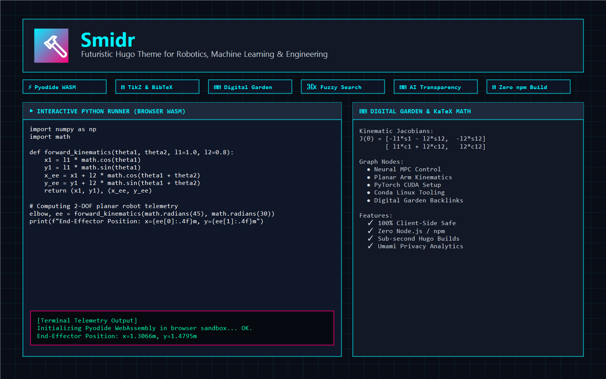

# Smidr 🔨

[](https://gohugo.io/)
[](LICENSE)
[](#)
[](#)
[-ff007a.svg?style=flat)](#)

A modern, tech-savvy, and futuristic Hugo theme engineered for **Robotics, Machine Learning, and Engineering** blogs, research portfolios, and digital gardens.

Named after the Old Norse smith / craftsman (*Smiðr*), it features an iconic cyber-forged aesthetic with vibrant neon gradients, responsive layouts, client-side WebAssembly code sandboxes, and zero server-side compute risks.

---



---

## ✨ Features at a Glance

### 🎨 Visual & Interface Design
- **Forged Cyber Aesthetic:** Multi-layer neon gradients (`#00f0ff` $\rightarrow$ `#8a2be2` $\rightarrow$ `#ff007a`), dark circuit patterns, and glassmorphism.
- **Instant Dark / Light Mode:** Smooth theme toggle (Dark by default, crisp high-contrast Light mode) synced with user system preferences and `localStorage`.
- **Command Palette (`Cmd+K` / `Ctrl+K`):** Instant modal fuzzy search across articles, tags, and categories without Google or external trackers.
- **Dynamic Away Tab Title & Favicon:** Changes to a glowing beacon hammer when the reader switches tabs so they never miss an update.
- **Mobile First Navigation:** Fluid responsive drawer menu with touch-friendly navigation for mobile phones and tablets.
- **Retro 404 Cyber Rover Game:** Playable jump & run HTML5 canvas mini-game on the 404 error page with local high-score tracking.

### 🔬 Interactive Engineering Experience
- **Browser WASM Code Runners (Pyodide):** Readers can tweak and execute Python algorithms directly within the article—zero cloud compute or server load.
- **Dynamic System Parameter Sliders:** Real-time HTML5 Canvas step response graphs with adjustable gain ($K_p$), damping ($\zeta$), and natural frequency ($\omega_n$).
- **Client-Side TikZ Diagrams:** Compiles LaTeX TikZ vector schemas directly in the browser using TikzJax WebAssembly.
- **BibTeX Citations & Reference Manager:** Sequential in-text numbering (`[1]`), hover tooltips, IEEE/ACM citations, and one-click BibTeX drawer copying.
- **Asciinema Terminal Replay:** Embed terminal CLI recordings (`.cast` files or cloud IDs) with interactive text selection.
- **Direct File Inclusion (`code-file`):** Reference actual `.py`, `.cpp`, `.rs`, or `.sh` files directly from your repository without copy-paste drift.

### 🧠 Digital Garden & Provenance
- **Contextual Bidirectional Backlinks:** Discovers and displays incoming article references (Obsidian/Roam style).
- **Interactive Knowledge Graph:** 2D force-directed canvas visualizing interconnected nodes, tags, and articles.
- **AI Transparency & Provenance Badges:** Discloses whether an article is the human original, translated via Ollama/AI, or AI-enhanced, with direct link to the source draft.
- **OpenPGP Key Verification Card:** Cryptographic fingerprint card with formatted blocks, one-click copy, and public key download button.
- **Giscus Comments:** Zero-cookie, privacy-friendly discussions powered by GitHub Discussions, synchronized with dark/light mode.
- **Inline Footnote Popovers:** Reveals footnote definitions on hover/tap without jumping the reader to the footer.
- **Community Sponsor / Ad Slots:** Discreet, privacy-respecting sponsorship card shortcodes (`` / ``).
- **Human-Readable RSS (XSLT):** RSS 2.0 XML styled with an XSLT template so browsers render a sleek preview instead of raw code.

---

## ⚡ 5-Minute Quickstart

### 1. Requirements
Ensure you have **Hugo Extended** version $\ge 0.120.0$ installed:
```bash
hugo version
```

### 2. Add Smidr to Your Hugo Site
```bash
# In your Hugo site root:
git submodule add https://github.com/smidr-theme/smidr.git themes/smidr
```

### 3. Configure `hugo.yaml`
Add `theme: smidr` to your `hugo.yaml`:
```yaml
baseURL: "https://yourdomain.com/"
title: "Smidr"
theme: "smidr"
defaultContentLanguage: "en"

outputs:
  home:
    - HTML
    - RSS
    - JSON # Required for Cmd+K search!
  page:
    - HTML
  section:
    - HTML
    - RSS
  taxonomy:
    - HTML
  term:
    - HTML

markup:
  goldmark:
    renderer:
      unsafe: true # Required for interactive widgets & canvas
  highlight:
    noClasses: false
    style: "dracula"
```

### 4. Create Your First Article
```bash
hugo new posts/my-first-simulation.md
```
This automatically populates the file with Smidr's comprehensive archetype and cheatsheet.

### 5. Launch the Local Dev Server
```bash
hugo server -D
```
Open [http://localhost:1313](http://localhost:1313) in your browser to experience your futuristic engineering blog!

---

## 📝 Shortcodes Cheatsheet

### 1. Interactive WebAssembly Code Runner (`code-runner`)
```markdown

import math

def forward_kinematics(theta1, theta2, l1=1.0, l2=0.8):
    x = l1 * math.cos(theta1) + l2 * math.cos(theta1 + theta2)
    y = l1 * math.sin(theta1) + l2 * math.sin(theta1 + theta2)
    return x, y

print("Tool Coordinates:", forward_kinematics(0.785, 0.523))

```

### 2. Direct Source File Inclusion (`code-file`)
```markdown

```

### 3. Dynamic Interactive Sliders (`interactive-widget`)
```markdown

```

### 4. Asciinema Terminal Cast Player (`asciinema`)
```markdown


```

### 5. Client-Side TikZ Diagrams (`tikz`)
*Ensure `tikz: true` is set in your post front matter:*
```markdown

\begin{tikzpicture}[>=stealth, line width=1.2pt]
  \fill[cyan] (0,0) circle (3pt) node[below] {Base};
  \draw[line width=3pt, cyan] (0,0) -- (1.5,1.5);
  \fill[magenta] (1.5,1.5) circle (3pt) node[above left] {$J_1$};
  \draw[line width=3pt, magenta] (1.5,1.5) -- (2.8,1.8);
  \fill[yellow] (2.8,1.8) circle (3pt) node[right] {EE};
\end{tikzpicture}

```

### 6. BibTeX In-Text Citations & Bibliography (`cite` and `bibliography`)
```markdown
According to Kalman  in state-space estimation...


@article{kalman1960,
  title = {A New Approach to Linear Filtering and Prediction Problems},
  author = {Kalman, Rudolph Emil},
  journal = {Journal of Basic Engineering},
  year = {1960},
  doi = {10.1115/1.3662552}
}

```

### 7. OpenPGP Cryptographic Verification Card (`pgp-card`)
```markdown

-----BEGIN PGP PUBLIC KEY BLOCK-----
Version: OpenPGP.js v5.1.0

... [ASCII Armored Key] ...
-----END PGP PUBLIC KEY BLOCK-----

```

### 8. Sponsor / Advertisement Card (`sponsor` & `ad`)
```markdown

```

### 9. Callout Boxes (`alert`)
```markdown

Ensure current limits are programmed into your ESC before enabling PID feedback!

```
*Supported types: `info`, `warning`, `caution`, `tip`, `robotics`.*

### 10. Secret Text (`secret`)
```markdown
Passcode: NEON-MATRIX-2026
```

---

## 🛡️ Privacy & Dual Deployment Architecture

### Anonymous Static Pages vs. Real-Name Server Builds
If you publish your blog under a pseudonym on **public git pages** (`https://username.github.io`) and under your real name on a **private server** (`https://your-domain.net`), you can use Hugo **Environments** without maintaining separate Git branches:

```text
config/
├── _default/
│   ├── hugo.yaml           # Common settings
│   └── params.yaml         # Pseudonym defaults (author: "Anonymous")
└── production/
    └── params.yaml         # Overrides for personal server (real name & imprint)
```

- **Public Static Pages (e.g. GitHub Pages):**
  ```bash
  hugo --minify -b "https://username.github.io"
  ```
- **Self-Hosted Server (e.g. Caddy Server):**
  ```bash
  hugo --environment production --minify -b "https://your-domain.net"
  ```

### Zero-Server-Load Guarantee
- Hugo outputs **100% static files**.
- Pyodide WebAssembly, TikzJax, and HTML5 Canvas calculations execute **entirely inside the visitor's browser thread**.
- No code is transmitted to or evaluated on your server.
- Completely immune to remote code injection (RCE), denial of service (DoS), or computational overload.

---

## 📄 License

Smidr is released under the [MIT License](LICENSE).
Feel free to use it for personal blogs, research laboratories, academic portfolios, and commercial projects.
